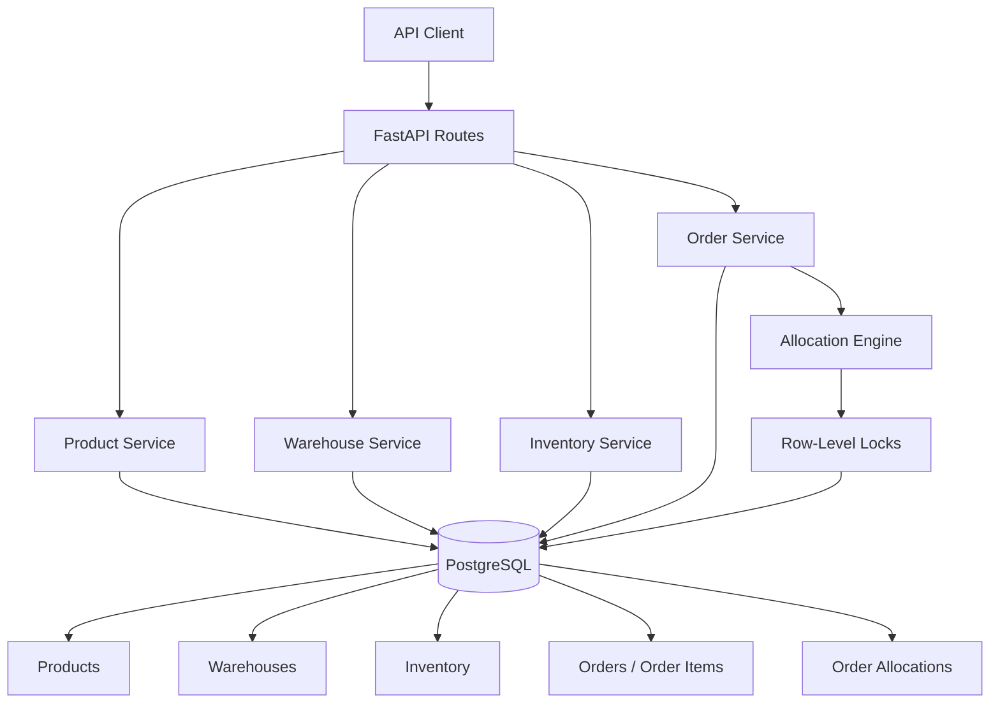

# StockFlow

A backend-focused inventory and order fulfillment system built with Python, FastAPI and PostgreSQL.

StockFlow models multi-warehouse stock, reservations, order allocation and fulfillment with explicit business rules, transactional consistency and concurrency protection.

> This is a portfolio and educational project designed to demonstrate backend engineering, database consistency and concurrent order-processing concepts.

## Features

### Product Management

* Create, list, update and delete products
* Unique SKU enforcement at the database level
* Validation for empty, malformed and duplicate data
* Deletion protection when a product is referenced by an order
* Deletion protection while physical stock still exists

### Warehouse Management

* Create, list, update and delete warehouses
* Unique warehouse names
* Pagination support
* Warehouse deletion protection while inventory entries exist

### Inventory Management

Stock is tracked independently for every product and warehouse.

Each inventory row contains:

```text
quantity           = physical stock
reserved_quantity  = stock reserved for allocated orders
available_quantity = quantity - reserved_quantity
```

Important database invariants:

```text
quantity >= 0
reserved_quantity >= 0
reserved_quantity <= quantity
```

The API prevents physical stock from being reduced below the quantity already reserved by active orders.

A product can have only one inventory row per warehouse.

### Order Lifecycle

Orders use an explicit state machine:

```text
PENDING ---- allocate ----> ALLOCATED ---- fulfill ----> FULFILLED
   |                           |
   |                           |
   +-------- cancel -----------+---------> CANCELLED
```

Rules include:

* New orders start as `PENDING`
* Only pending orders can be edited
* Only pending orders can be hard-deleted
* Pending orders can be cancelled directly
* Allocation changes an order from `PENDING` to `ALLOCATED`
* Fulfillment is allowed only from `ALLOCATED`
* Allocated orders can be cancelled and their reservations are released
* Fulfilled and cancelled orders are terminal states

### Multi-Warehouse Allocation

An order item can be fulfilled from multiple warehouses.

Example:

```text
Order:
12 units of Product A

Inventory:
Riga       7 available
Tallinn   10 available

Allocation:
Riga       7
Tallinn    5
```

The allocation process:

1. Locks the order row.
2. Loads inventory for all products in the order.
3. Locks relevant inventory rows using `SELECT ... FOR UPDATE`.
4. Calculates available stock after existing reservations.
5. Splits demand across warehouses when necessary.
6. Creates `OrderAllocation` records.
7. Increases `reserved_quantity`.
8. Changes the order status to `ALLOCATED`.
9. Commits everything atomically.

If any order item cannot be fully allocated, the entire transaction is rolled back.

### Fulfillment

Fulfilling an allocated order converts reserved stock into consumed physical stock.

For every allocation:

```text
quantity          -= allocation.quantity
reserved_quantity -= allocation.quantity
```

Example:

```text
Before fulfillment:

quantity = 20
reserved_quantity = 6

Fulfill allocation of 6 units

After fulfillment:

quantity = 14
reserved_quantity = 0
available_quantity = 14
```

Defensive checks prevent corrupted reservation state from producing negative inventory.

### Cancellation

Cancelling a pending order only changes its state.

Cancelling an allocated order releases its reservations:

```text
quantity           remains unchanged
reserved_quantity -= allocation.quantity
```

Historical allocation records are preserved after cancellation and fulfillment.

### Historical Allocation Protection

`OrderAllocation` records reference the inventory rows that were used during allocation.

Inventory rows referenced by historical allocations cannot be deleted, even when:

```text
quantity = 0
reserved_quantity = 0
```

This preserves fulfillment history and prevents dangling references.

### Concurrency Protection

Stock allocation and lifecycle transitions use PostgreSQL row-level locking with:

```sql
SELECT ... FOR UPDATE
```

Inventory rows are locked in a deterministic order before reservations are modified.

This prevents concurrent orders from reserving the same stock beyond the available quantity.

Example concurrency scenario:

```text
Inventory:
10 available

Order A requests 10
Order B requests 10

Both allocate concurrently
```

Expected result:

```text
one order  -> ALLOCATED
one order  -> 409 Conflict
reserved_quantity -> 10
```

The integration suite includes a concurrent allocation test for this behavior.

### Transaction Safety

Business operations are executed inside explicit database transactions.

Examples include:

* Product updates
* Warehouse updates
* Inventory changes
* Order updates
* Allocation
* Fulfillment
* Cancellation

Database constraints act as the final integrity layer, while service-level validation returns domain-specific API errors.

## Architecture



The application is split into:

```text
API layer
    ↓
Pydantic schemas
    ↓
Service layer / business rules
    ↓
SQLAlchemy models and transactions
    ↓
PostgreSQL
```

Expected application errors are mapped to HTTP responses through centralized exception handlers.

## Data Model

Core entities:

```text
Product
   |
   +---- Inventory ---- Warehouse
   |         |
   |         +---- OrderAllocation
   |                    |
   +---- OrderItem -----+
            |
            +---- Order
```

### Product

```text
id
name
sku
```

### Warehouse

```text
id
name
location
```

### Inventory

```text
id
product_id
warehouse_id
quantity
reserved_quantity
available_quantity
```

`available_quantity` is calculated dynamically and is not stored as a separate database column.

### Order

```text
id
status
created_at
```

### OrderItem

```text
id
order_id
product_id
quantity
position
```

### OrderAllocation

```text
id
order_item_id
inventory_id
quantity
```

An allocation records exactly which inventory row supplied part of an order item.

## Database Constraints

StockFlow intentionally keeps important invariants in PostgreSQL as well as in the service layer.

Examples:

* Unique product SKU
* Unique warehouse name
* Unique `(product_id, warehouse_id)` inventory pair
* Inventory quantity cannot be negative
* Reserved quantity cannot be negative
* Reserved quantity cannot exceed physical quantity
* Order item quantity must be positive
* Order item position must be positive
* A product can appear only once in an order
* Order item positions are unique inside an order
* Allocation quantity must be positive
* One allocation per `(order_item_id, inventory_id)` pair
* Foreign-key protection for historical data

Named database constraints are used so integrity violations can be mapped to meaningful domain errors.

## API Overview

### Products

```http
POST   /products
GET    /products
GET    /products/{product_id}
PATCH  /products/{product_id}
DELETE /products/{product_id}
```

### Warehouses

```http
POST   /warehouses
GET    /warehouses
GET    /warehouses/{warehouse_id}
PATCH  /warehouses/{warehouse_id}
DELETE /warehouses/{warehouse_id}
```

### Inventory

```http
POST   /warehouses/{warehouse_id}/inventory
GET    /warehouses/{warehouse_id}/inventory
PATCH  /warehouses/{warehouse_id}/inventory/{product_id}
DELETE /warehouses/{warehouse_id}/inventory/{product_id}
```

### Orders

```http
POST   /orders
GET    /orders
GET    /orders/{order_id}
PATCH  /orders/{order_id}
DELETE /orders/{order_id}

POST   /orders/{order_id}/allocate
POST   /orders/{order_id}/fulfill
POST   /orders/{order_id}/cancel
```

## Example Order Flow

Create a product:

```http
POST /products
```

```json
{
  "name": "NVIDIA RTX 5090",
  "sku": "RTX5090"
}
```

Create a warehouse:

```http
POST /warehouses
```

```json
{
  "name": "Riga Warehouse",
  "location": "Riga, Latvia"
}
```

Add inventory:

```http
POST /warehouses/{warehouse_id}/inventory
```

```json
{
  "product_id": "PRODUCT_UUID",
  "quantity": 10
}
```

Create an order:

```http
POST /orders
```

```json
{
  "items": [
    {
      "product_id": "PRODUCT_UUID",
      "quantity": 6
    }
  ]
}
```

Allocate stock:

```http
POST /orders/{order_id}/allocate
```

Inventory becomes:

```json
{
  "quantity": 10,
  "reserved_quantity": 6,
  "available_quantity": 4
}
```

Fulfill the order:

```http
POST /orders/{order_id}/fulfill
```

Inventory becomes:

```json
{
  "quantity": 4,
  "reserved_quantity": 0,
  "available_quantity": 4
}
```

## Error Handling

Expected application errors are represented by domain exceptions and mapped centrally to HTTP responses.

Typical responses:

```text
404 Not Found
    Requested product, warehouse, inventory or order does not exist.

409 Conflict
    Operation conflicts with the current resource state.
    Examples:
    - duplicate SKU
    - duplicate warehouse name
    - insufficient inventory
    - invalid order state transition
    - reducing stock below reserved quantity
    - deleting inventory referenced by an allocation

422 Unprocessable Content
    Request or business validation failed.
```

Unexpected database integrity errors are not silently converted and are allowed to surface during development.

## Tech Stack

**Backend**

* Python 3.13
* FastAPI
* Pydantic

**Database**

* PostgreSQL 16
* SQLAlchemy 2.x
* Async SQLAlchemy sessions
* psycopg
* Alembic

**Infrastructure**

* Docker
* Docker Compose

**Testing**

* pytest
* pytest-asyncio
* HTTPX
* Async ASGI integration tests

## Project Structure

```text
StockFlow/
├── alembic/
│   ├── versions/
│   └── env.py
├── app/
│   ├── api/
│   │   ├── routes/
│   │   │   ├── inventory.py
│   │   │   ├── orders.py
│   │   │   ├── products.py
│   │   │   └── warehouses.py
│   │   └── exception_handlers.py
│   ├── core/
│   │   ├── config.py
│   │   └── exceptions.py
│   ├── db/
│   │   ├── base.py
│   │   ├── errors.py
│   │   └── session.py
│   ├── domain/
│   │   └── order.py
│   ├── models/
│   │   ├── inventory.py
│   │   ├── order.py
│   │   ├── order_allocation.py
│   │   ├── order_item.py
│   │   ├── product.py
│   │   └── warehouse.py
│   ├── schemas/
│   ├── services/
│   │   ├── inventory/
│   │   ├── order/
│   │   ├── product/
│   │   └── warehouse/
│   └── main.py
├── tests/
│   ├── integration/
│   │   ├── test_inventory.py
│   │   ├── test_orders.py
│   │   ├── test_products.py
│   │   └── test_warehouses.py
│   ├── conftest.py
│   └── factories.py
├── .env.example
├── docker-compose.yml
├── pytest.ini
├── requirements.txt
└── README.md
```

## Running the Project

Clone the repository:

```bash
git clone https://github.com/Sunnez/StockFlow.git
cd StockFlow
```

Create a virtual environment.

Windows PowerShell:

```powershell
python -m venv .venv
.venv\Scripts\Activate.ps1
```

Linux/macOS:

```bash
python -m venv .venv
source .venv/bin/activate
```

Install dependencies:

```bash
pip install -r requirements.txt
```

Create the environment file:

```bash
cp .env.example .env
```

On Windows PowerShell:

```powershell
Copy-Item .env.example .env
```

Update the PostgreSQL password in `.env` and keep the credentials in `DATABASE_URL` and `TEST_DATABASE_URL` consistent with it.

Start PostgreSQL:

```bash
docker compose up -d
```

The development database is exposed only on the local machine:

```text
127.0.0.1:5433
```

The test database is exposed on:

```text
127.0.0.1:5434
```

Apply all migrations:

```bash
alembic upgrade head
```

Start the API:

```bash
uvicorn app.main:app --reload
```

The API will be available at:

```text
http://127.0.0.1:8000
```

Swagger documentation:

```text
http://127.0.0.1:8000/docs
```

Health endpoint:

```text
http://127.0.0.1:8000/health
```

## Testing

Make sure the test PostgreSQL container is running:

```bash
docker compose up -d db_test
```

Run the complete integration test suite:

```bash
pytest -v
```

Tests cover:

* Product CRUD and validation
* Warehouse CRUD and validation
* Inventory CRUD
* Inventory reservation invariants
* Order CRUD
* Order state transitions
* Single-warehouse allocation
* Multi-warehouse allocation
* Existing reservation handling
* Insufficient-stock rollback
* Multi-product atomic rollback
* Duplicate allocation protection
* Fulfillment
* Duplicate fulfillment protection
* Pending and allocated cancellation
* Reservation release on cancellation
* Historical allocation protection
* Concurrent allocation / over-reservation protection

The test suite uses a dedicated PostgreSQL database and async HTTP requests against the FastAPI application.

## Alembic Migration Validation

The full migration chain has been verified against an empty PostgreSQL database.

Useful commands:

```bash
alembic upgrade head
alembic current
alembic check
```

`alembic check` should report:

```text
No new upgrade operations detected.
```

This verifies that the database schema produced by all migrations matches the current SQLAlchemy model metadata.

## Security Notes

Database ports in Docker Compose are bound to loopback only:

```text
127.0.0.1
```

This prevents the development PostgreSQL instances from being exposed on all host network interfaces by default.

Secrets are not committed to the repository.

`.env` is ignored by Git, while `.env.example` contains only placeholder credentials.

## Key Engineering Concepts Demonstrated

* REST API design
* Asynchronous Python
* FastAPI dependency injection
* Pydantic validation
* Service-layer architecture
* SQLAlchemy 2.x ORM
* PostgreSQL constraints
* Named database constraints
* Alembic migrations
* Transaction management
* Atomic multi-step operations
* Row-level locking
* Race-condition protection
* Multi-warehouse inventory
* Inventory reservations
* Order allocation
* Order state machines
* Rollback on partial failure
* Historical data integrity
* Domain-specific exception handling
* Pagination
* Integration testing
* Concurrent request testing
* Dockerized PostgreSQL development environment
