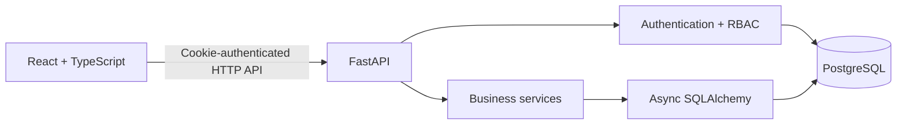

# StockFlow

**Multi-tenant inventory and order management platform** built with FastAPI, PostgreSQL, React, and TypeScript.

StockFlow provides a web interface for managing organizations, team permissions, products, warehouses, stock levels, and the complete order fulfillment lifecycle. Inventory operations are backed by PostgreSQL transactions and row-level locks to keep stock and reservations consistent under concurrent requests.

## Features

- **Organizations and access control:** create and manage organizations, add existing users as members, and enforce organization-scoped permissions with OWNER, ADMIN, MANAGER, and VIEWER roles.
- **Authentication:** registration, login, session refresh, and logout with HttpOnly JWT cookies, server-side sessions, refresh token rotation, and CSRF protection.
- **Products:** create, browse, update, and delete products; SKU uniqueness is enforced within each organization.
- **Warehouses:** manage multiple warehouses and their locations, with organization-local warehouse names.
- **Inventory:** track physical, reserved, and available quantities per product and warehouse. Prevent stock reductions below existing reservations.
- **Orders:** create and edit pending orders, allocate stock across warehouses, fulfill allocated orders, or cancel and release reservations.
- **Web dashboard:** responsive interface for day-to-day operations, forms, tables, order details, and role-aware controls.

## Order lifecycle

```text
PENDING ── allocate ──> ALLOCATED ── fulfill ──> FULFILLED
   │                       │
   └────── cancel ──────────┴──────> CANCELLED
```

Stock quantities follow these rules:

```text
available_quantity = quantity - reserved_quantity
0 <= reserved_quantity <= quantity
```

During **allocation**, StockFlow locks the relevant order and inventory rows, splits the required quantity across warehouses if needed, and reserves stock in a single transaction. If any item cannot be allocated completely, the transaction rolls back.

During **fulfillment**, both physical stock and its reservation are reduced. **Cancellation** of an allocated order releases reservations without reducing physical stock. Allocation records are retained for history.

## Architecture



The backend separates HTTP routes, Pydantic schemas, transactional services, and SQLAlchemy models. Every business resource is scoped to an organization. Tenant-aware queries and composite foreign keys prevent cross-organization references; PostgreSQL constraints and deterministic row locking protect stock consistency.

## Tech stack

| Layer | Technologies |
| --- | --- |
| Frontend | React, TypeScript, Vite, React Router, TanStack Query, Tailwind CSS |
| Backend | Python 3.13, FastAPI, Pydantic v2, JWT, Argon2 |
| Database | PostgreSQL 16, SQLAlchemy 2 (async), Alembic |
| Infrastructure | Docker, Docker Compose |
| Testing | pytest, pytest-asyncio, HTTPX, Vitest |

## Getting started

Requirements: **Python 3.13**, **Node.js 22.12+**, npm, and Docker with Docker Compose.

1. Configure the backend using `.env.example` as a starting point. Set database credentials and independent `JWT_SECRET_KEY` and `CSRF_SECRET_KEY` values. For local HTTP, configure the allowed frontend origin and development cookie settings.
2. Start PostgreSQL and apply the migrations:

   ```powershell
   docker compose up -d --wait
   alembic upgrade head
   ```

3. Start the API from the repository root (with the Python virtual environment and requirements installed):

   ```powershell
   uvicorn app.main:app --reload --host 127.0.0.1 --port 8000
   ```

4. Start the frontend in a second terminal:

   ```powershell
   cd frontend
   npm ci
   npm run dev
   ```

| Service | Local URL |
| --- | --- |
| Web app | http://localhost:5173 |
| API documentation | http://localhost:8000/docs |
| API health | http://localhost:8000/health |

Use `localhost` consistently for the frontend and API so browser cookies and CSRF work as intended. The Vite development server does not start the API automatically.

For environment configuration, clean-database migration prerequisites, and test database setup, see **[Setup guide](docs/SETUP.md)**. Frontend-specific details are in **[frontend/README.md](frontend/README.md)**.

## API overview

All business endpoints are organization-scoped under `/organizations/{organization_id}` (UUID or slug).

| Area | Main endpoints |
| --- | --- |
| Authentication | `/auth/register`, `/auth/login`, `/auth/refresh`, `/auth/logout`, `/users/me` |
| Organizations | `/organizations`, `/organizations/{organization_id}`, `/organizations/{organization_id}/members` |
| Products | `/organizations/{organization_id}/products` |
| Warehouses | `/organizations/{organization_id}/warehouses` |
| Inventory | `/organizations/{organization_id}/warehouses/{warehouse_id}/inventory` |
| Orders | `/organizations/{organization_id}/orders` and `/{order_id}/allocate`, `/{order_id}/fulfill`, `/{order_id}/cancel` |

The OpenAPI specification at `/docs` provides the exact request and response schemas. Business read access is available to organization members; write operations require an appropriate role and CSRF validation.

## Tests

```powershell
# Backend unit tests
python -m pytest tests/unit -q

# Frontend checks
cd frontend
npm run typecheck
npm run lint
npm test
npm run build
```

PostgreSQL integration tests use a dedicated disposable test database and can modify or recreate its tables. Follow the safety requirements in [docs/SETUP.md](docs/SETUP.md) before running them; do not point them at the development database.
